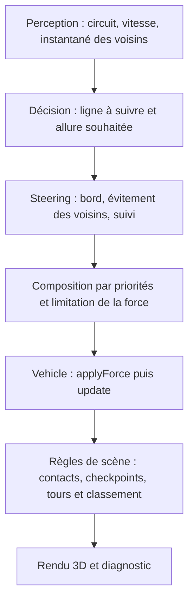

# Morph Rally — Grand Prix Atlas

**Une course de huit GT autonomes en 3D pour explorer les steering behaviors.**

Sur le circuit côtier de l’Atlas, les pilotes choisissent leur trajectoire, adaptent leur allure et anticipent les rapprochements avec leurs adversaires. Le joueur prend les décisions tactiques : choisir son écurie, changer de stratégie et utiliser le boost au bon moment.

**[Jouer dans le navigateur](https://yassine-atiki.github.io/MorphRally/)** · [Commandes](#commandes) · [Fonctionnement de l’IA](#fonctionnement-de-lia) · [Installation locale](#installation-locale)

## Présentation

Morph Rally associe une expérience de course et un outil d’observation des comportements autonomes. Il permet de voir comment des forces simples, combinées avec des priorités, produisent une conduite progressive dans un environnement partagé.

| La course | La simulation |
|---|---|
| Huit pilotes et huit livrées de GT | Voitures spécialisées à partir de la classe `Vehicle` |
| Trois tours sur un circuit fermé | Suivi de trajectoire et adaptation à la courbure |
| Départ sur grille et classement en direct | Évitement prédictif des voisins et des bords |
| Tactiques et réserve de boost rechargeable | Forces bornées et intégration à pas fixe |
| Caméras de poursuite et aérienne | Inspecteur des sondes, forces et anticipations |

Le projet s’inscrit dans une démarche pédagogique autour des travaux de [Craig W. Reynolds](https://www.red3d.com/cwr/steer/gdc99/). Le pilotage actuel repose sur des comportements programmés ; il ne comporte ni réseau neuronal ni algorithme génétique.

## Prendre le départ

1. Ouvrir [Morph Rally](https://yassine-atiki.github.io/MorphRally/) dans un navigateur avec WebGL activé.
2. Choisir une écurie sur la grille de présentation.
3. Cliquer sur **Prendre le départ**.
4. Adapter la tactique pendant la course et maintenir **Espace** pour demander le boost.
5. Observer le classement, les temps au tour et la réserve d’énergie jusqu’au drapeau à damier.

Les pilotes conduisent de manière autonome. Le joueur intervient sur leur tactique et le boost. Cliquer sur un pilote dans le classement permet de le suivre et de lui appliquer les commandes tactiques.

Le boost consomme une réserve rechargeable et s’active sur les portions suffisamment droites. Il reste indisponible dans les virages serrés ou lorsque la réserve est épuisée.

## Commandes

| Touche ou contrôle | Action |
|---|---|
| **1** | Tactique prudente |
| **2** | Tactique équilibrée |
| **3** | Tactique d’attaque |
| **Espace** ou bouton **Boost** maintenu | Demander le boost |
| **C** | Alterner entre poursuite et vue aérienne |
| **P** | Mettre en pause ou reprendre |
| **D** ou bouton **Debug** | Ouvrir ou fermer l’inspecteur |
| **Un pas**, dans l’inspecteur en pause | Avancer d’une étape de simulation |
| **R** ou bouton **Rejouer** | Revenir à la grille de départ |
| **Son** et curseur **Volume** | Activer, couper et régler le mix audio |
| **Graphismes** | Alterner entre qualité élevée et légère |
| **Plein écran** | Agrandir le jeu, si le navigateur le permet |

La perte de focus met une course en pause et coupe le mix audio. Le son se déverrouille après une interaction avec le jeu ; son volume initial est de **30 %**.

## Fonctionnement de l’IA

La conduite suit trois responsabilités distinctes :



### Suivi et anticipation

Chaque pilote vise un point en avant sur sa ligne de course. La distance d’anticipation augmente avec la vitesse. L’allure souhaitée tient compte de la courbure à venir, de la tactique choisie et du trafic devant la voiture.

Le principe du steering consiste à corriger progressivement la vitesse :

```text
Force de direction = vitesse souhaitée − vitesse actuelle
```

Les comportements pondèrent cette correction. La force résultante est bornée avant son application.

### Évitement et priorités

Les voitures prédisent les rapprochements avec leurs voisines et leur proximité future avec les bords du circuit. Les forces sont composées dans l’ordre suivant :

1. Évitement du bord.
2. Évitement prédictif des autres voitures.
3. Suivi de la ligne dans le budget restant.

Les décisions des pilotes utilisent un instantané commun du voisinage. Chaque voiture applique ensuite sa force et réalise une seule intégration héritée par pas.

### Temps et progression

La simulation utilise des pas fixes à **60 Hz**, avec un rattrapage borné en cas de ralentissement du rendu. Ce réglage ne garantit pas 60 images affichées par seconde : la fréquence du rendu dépend de la machine.

Les tours sont validés par **60 checkpoints ordonnés et orientés**. Les contacts sont traités par des tests balayés, séparément du steering. Le classement tient compte de la progression puis des temps d’arrivée.

## Inspecter la conduite

Le mode **Debug** expose les données de la voiture sélectionnée :

- **Sondes** : cinq rayons à −60°, −30°, 0°, +30° et +60°, sur une portée de 150 unités.
- **Forces** : suivi, bord, voisins et résultante effectivement appliquée.
- **Anticipation** : projection du mouvement et situations de rapprochement.
- **Ligne** : corridor, ligne choisie et point de suivi.

Les sondes mesurent la distance aux murs. Une valeur normalisée proche de 1 indique un mur proche ; une valeur proche de 0 indique un mur éloigné ou absent dans la portée. Elles servent au diagnostic et ne constituent pas les entrées du contrôleur de conduite.

Pour analyser une décision, mettre le jeu en pause avec **P**, ouvrir **D**, puis utiliser **Un pas**. Le point doré représente la cible de suivi ; la flèche bleue représente la vitesse. Le diagnostic observe la simulation sans modifier les trajectoires.

## Parcours conseillé pour une démonstration

1. **Présenter la course** : écuries, circuit, départ et classement.
2. **Montrer les décisions tactiques** : prudent, équilibré, attaque et boost sur une portion droite.
3. **Passer en vue aérienne** pour observer le peloton et les changements de ligne.
4. **Mettre en pause et ouvrir le diagnostic** pour expliquer les forces et l’anticipation.
5. **Avancer d’un pas** pour relier la force appliquée au changement de vitesse et de position.

Ce parcours permet de présenter l’expérience de jeu et les principes de steering qui produisent les déplacements.

## Graphismes et audio

Le monde est rendu avec **p5.js et WebGL** : voitures GT construites en géométrie procédurale, huit livrées, bordures, stands, tribunes, forêt, mer et relief. La scène occupe l’écran et propose deux niveaux de qualité.

L’audio combine :

- un enregistrement moteur dont la lecture varie avec le régime et la charge ;
- six rapports sonores et des transitions de régime ;
- un mixage des adversaires proches avec atténuation et placement stéréo ;
- un effet nitro avec attaque, souffle de maintien et extinction au relâchement.

Le mode **Graphismes : légers** réduit le décor et la résolution de la scène pour diminuer le coût du rendu.

## Installation locale

### Prérequis

- Un navigateur récent avec JavaScript et WebGL activés.
- Python 3 pour lancer le petit serveur HTTP ci-dessous.
- Git pour cloner le dépôt, ou l’option **Code → Download ZIP** sur GitHub.

### Lancer le jeu

```bash
git clone https://github.com/Yassine-Atiki/MorphRally.git
cd MorphRally
python -m http.server 8000 --bind 127.0.0.1
```

Ouvrir ensuite **[http://127.0.0.1:8000/](http://127.0.0.1:8000/)**.

Selon l’installation, la commande Python peut être `python3` ou `py`. Aucun `npm install`, compilation ou compte utilisateur n’est nécessaire pour jouer. Les scripts et le fichier audio sont livrés dans le dépôt.

## Organisation du dépôt

```text
MorphRally/
├── index.html                Entrée et structure de l’interface
├── race.css                  Présentation et adaptation de l’interface
├── audio-credits.html        Crédits audio accessibles depuis le jeu
├── .nojekyll                 Publication des fichiers statiques sur GitHub Pages
├── js/
│   ├── vehicle.js            Base Vehicle
│   ├── racingCar.js          Pilotes et steering de course
│   ├── raceTrack.js          Circuit, murs et checkpoints
│   ├── raceDirector.js       Départ, progression, contacts et classement
│   ├── raceClock.js          Horloge de simulation
│   ├── raceDiagnostics.js    Capture des données de diagnostic
│   ├── raceDebugRenderer.js  Affichage des repères de diagnostic
│   ├── raceMesh.js           Construction des géométries
│   ├── raceMaterials.js      Matériaux et éclairage
│   ├── raceRenderer3D.js     Monde 3D et caméras
│   ├── raceHud.js            Commandes et interface de course
│   ├── engineSoundModel.js   Régime et rapports sonores
│   ├── raceAudio.js          Graphe audio et mixage
│   ├── raceSketch.js         Initialisation, boucle et nettoyage
│   ├── geometry.js           Calculs géométriques et contacts
│   ├── path.js               Géométrie du chemin
│   ├── spatialGrid.js        Recherche spatiale des murs
│   ├── obstacle.js           Entités obstacles
│   ├── raySensor.js          Mesure des rayons de diagnostic
│   ├── p5.min.js             Bibliothèque p5.js 1.7.0
│   └── p5-LICENSE.txt        Licence de p5.js
└── assets/
    └── audio/
        ├── engine-gt.wav     Enregistrement moteur
        └── CREDITS.md        Source et attribution de l’enregistrement
```

Le rendu et l’interface lisent l’état de la course. Les forces spécialisées appartiennent à `RacingCar`, qui hérite de `Vehicle` ; la classe de base est conservée sans modification.

## Validation et limites

Avant publication, la version locale a passé **42 tests unitaires** couvrant notamment les forces, la locomotion, les contacts, les tours, le diagnostic et l’audio. La réorganisation des scripts a également été vérifiée par **sept contrôles d’intégration dans Chromium** : chargement, mouvement, diagnostic, caméra, nitro, redimensionnement et rejeu.

Ce dépôt contient la version statique destinée à l’exécution et à la publication. Les suites de tests et les rapports détaillés sont conservés dans l’environnement de développement pédagogique ; ils ne sont pas inclus ici.

Le modèle de mouvement est plan, avec un rendu 3D et des contacts circulaires. La suspension, les pneumatiques et une boîte de vitesses physique ne sont pas simulés. Le régime et les rapports servent à la présentation sonore. La fluidité dépend du navigateur, du GPU et du niveau de qualité choisi.

## Crédits et références

- **Projet** : [Yassine-Atiki](https://github.com/Yassine-Atiki).
- **Steering behaviors** : Craig W. Reynolds, [Steering Behaviors for Autonomous Characters, GDC 1999](https://www.red3d.com/cwr/steer/gdc99/).
- **Bibliothèque graphique** : p5.js 1.7.0 ; [licence LGPL 2.1 livrée](js/p5-LICENSE.txt).
- **Enregistrement moteur** : qubodup, [Car Engine Loop 96kHz, 4s](https://opengameart.org/content/car-engine-loop-96khz-4s), sous [CC BY 3.0](https://creativecommons.org/licenses/by/3.0/). Le WAV est livré sans modification ; les traitements sont appliqués en mémoire à la lecture.
- **Attributions audio** : [détails de la source](assets/audio/CREDITS.md) et [page de crédits du jeu](audio-credits.html).
